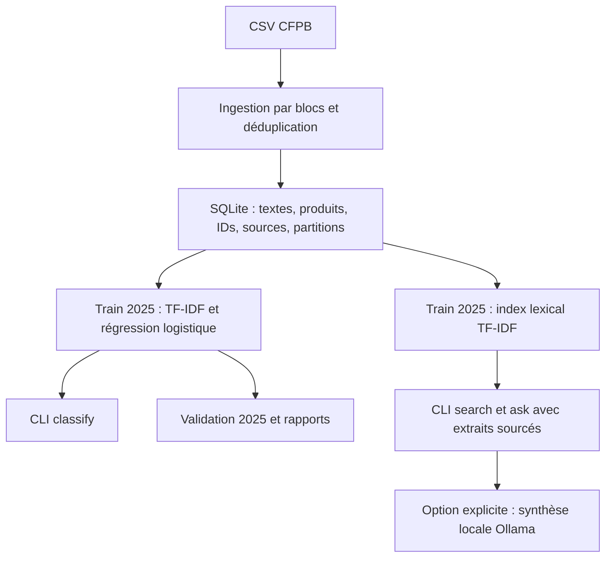

# FinComplaint AI

Classification des réclamations financières, recherche documentaire et réponses sourcées sur les archives du Consumer Financial Protection Bureau (CFPB).

**Équipe : SAIM Bahaeddine et OUNI Hazem.** Projet académique NLP en binôme.

**Problématique :** comment classer une réclamation par produit financier, retrouver des récits similaires et fournir une réponse dont les sources sont consultables ?

L'implémentation comprend une baseline CPU TF-IDF + régression logistique, une recherche **lexicale** TF-IDF, un démonstrateur en ligne de commande et quatre notebooks commentés. Le mode de réponse par défaut restitue des extraits sourcés. La génération RAG par modèle local Ollama est facultative et n'a pas été évaluée avec un modèle réel. DistilBERT, BM25, embeddings, FAISS, FastAPI et Streamlit restent des extensions possibles.

## Livrables remis

| Attendu | Fichiers |
| --- | --- |
| Notebooks commentés | [Préparation](notebooks/01_preparation.ipynb), [modèles](notebooks/02_modeles.ipynb), [recherche et RAG](notebooks/03_rag.ipynb), [évaluation](notebooks/04_evaluation.ipynb) |
| Démonstrateur avec exemples | `src/demo.py`, commandes ci-dessous |
| Présentation, équipe, données, architecture, installation, résultats, limites | Ce README |
| Dépendances et configuration | `requirements.txt`, `requirements-notebooks.txt`, `.env.example` |
| Preuves et métriques | [Résultats](reports/demo/RESULTS.md), `reports/demo/baseline_metrics.json`, `confusion_validation.csv`, `examples.json`, `manifest.json` |
| Dataset | Liens officiels et procédure ci-dessous |

Les preuves concernent un échantillon réel explicitement limité. L'évaluation finale de la recherche et de la génération reste à réaliser ; les contrôles fonctionnels ne la remplacent pas.

## Origine et conditions de réutilisation du dataset

Source : [CFPB Consumer Complaint Database Narratives Archive](https://www.consumerfinance.gov/foia-requests/foia-electronic-reading-room/cfpb-consumer-complaint-database-narratives-archive/). L'archive annonce des réclamations reçues jusqu'au 14 août 2026. Notre périmètre couvre six exports 2025 et sept exports 2026 (janvier–février, puis mars à août). L'ingestion vérifie les dates effectivement conservées.

**Licence et conditions :** la page d'archive n'indique pas de licence dédiée aux récits. Les [mentions officielles CFPB](https://www.consumerfinance.gov/privacy/website-privacy-policy/#legal-notices) distinguent les contenus créés par le Bureau, dans le domaine public, des contenus de tiers pouvant relever d'autres droits. Nous n'attribuons donc pas de licence CC0 ou MIT aux témoignages. La remise peut contenir les liens et instructions, sans joindre les CSV. Les droits du dataset sont distincts de ceux du code. Consulter les conditions officielles avant redistribution.

Téléchargement :

1. Ouvrir l'archive officielle et télécharger les **Full Records** de janvier–février 2025 à août 2026.
2. Extraire les CSV si nécessaire et les placer à la racine du dépôt, en conservant les noms officiels `CCDB_Export_9_…csv` à `CCDB_Export_21_…csv`.
3. La démonstration rapide nécessite seulement les six exports contenant `2025` dans leur nom. Pour le pipeline complet, vérifier la présence des treize fichiers avant de produire le rapport final : le programme traite les fichiers présents, sans télécharger les absents.
4. Si les CSV sont obtenus depuis ce dépôt via Git LFS : installer Git LFS et exécuter `git lfs pull`. L'ingestion détecte les pointeurs LFS non téléchargés.

Les [descriptions des champs CFPB](https://www.consumerfinance.gov/complaint/data-use/) documentent les métadonnées. Colonnes requises : `Complaint ID`, `Date received`, `Product`, `Consumer complaint narrative`. `Issue` est conservée lorsqu'elle existe.

Les CSV déjà présents sont suivis par Git LFS et représentent plusieurs Go. Les commandes de démonstration les lisent sans les modifier. Les données dérivées et modèles sont régénérés localement ; les preuves conservent les ID, fichiers sources et aperçus brefs.

## Architecture implémentée



- `src/ingestion.py` lit par blocs de 10 000 lignes, conserve le texte original et filtre les dates 2025–2026. Déduplication globale par ID et texte normalisé ; la première occurrence dans l'ordre numérique des exports est conservée.
- Les textes **2025** sont répartis par hash déterministe : environ 80 % train, 20 % validation. Les textes **2026** sont réservés au test temporel.
- `src/classifier.py` ajuste le vectoriseur et le classifieur uniquement sur le train. Limites par défaut : 30 000 textes train et 10 000 par partition évaluée, triés par hash, sans stratification.
- `src/retriever.py` indexe séparément au maximum 10 000 récits train. Les scores sont des similarités cosinus. Chaque résultat contient ID, produit, date, fichier source et extrait de 1 200 caractères maximum.
- `src/rag.py` restitue les extraits ou les transmet au modèle local avec une consigne de citation. Le contrôle des IDs cités ne garantit pas la fidélité des affirmations.

```text
notebooks/                  Préparation, modèles, RAG, évaluation
src/                        Ingestion, classification, recherche, réponses, CLI
scripts/prepare_demo.py      Échantillonnage réel, entraînement, preuves
scripts/create_notebooks.py  Génération des notebooks (efface leurs sorties si relancé)
tests/                      Ingestion, séparation des données, recherche, citations
reports/demo/               Résultats et manifeste versionnables
data/processed/             SQLite générés, exclus de Git
artifacts/                  Modèles et index générés, exclus de Git
```

## Installation et configuration

Python **3.11 ou supérieur**. Les versions effectivement utilisées sont consignées dans `reports/demo/manifest.json`.

```bash
python -m venv .venv
```

Activation Windows PowerShell :

```powershell
.venv\Scripts\Activate.ps1
```

Activation Linux/macOS :

```bash
source .venv/bin/activate
```

Depuis la racine du dépôt :

```bash
python -m pip install -r requirements.txt
```

Pour ouvrir et réexécuter les notebooks :

```bash
python -m pip install -r requirements-notebooks.txt
jupyter lab
```

**Aucune clé API requise.** `.env.example` décrit la variable facultative `OLLAMA_MODEL`. Les fichiers `.env` ne sont pas chargés automatiquement et sont exclus de Git. Ne jamais publier de clé ou jeton dans le code, les notebooks, leurs sorties ou les rapports.

## Démonstration rapide reproductible

Après téléchargement des six exports 2025 :

```bash
python -m scripts.prepare_demo
python -m src.demo classify "I dispute a charge on my credit card" --artifacts artifacts/demo
python -m src.demo search "credit report identity theft" --artifacts artifacts/demo --top-k 3
python -m src.demo ask "mortgage payment escrow" --artifacts artifacts/demo
python -m src.demo ask "quasar nebula astrophysics" --artifacts artifacts/demo
python -m unittest discover -s tests -v
```

Le script lit les **3 000 premières lignes de chacun des six exports 2025**, puis applique le nettoyage. Il crée `data/processed/demo.sqlite`, les modèles dans `artifacts/demo/` et les preuves dans `reports/demo/`. Le manifeste enregistre les tailles des fichiers originaux, les empreintes SHA-256 des CSV échantillonnés et les versions. Cette commande remplace les anciens résultats de démonstration, avec des chemins distincts de ceux du pipeline complet.

Exécuter ensuite les notebooks 01 à 04. Le notebook 02 compare la baseline à la classe majoritaire ; le 03 compare les sources pour k=3 et k=5 ; le 04 contrôle les extraits et références. Les sorties sont conservées dans les notebooks remis.

Pour les exécuter automatiquement et enregistrer leurs sorties : `python -m scripts.execute_notebooks` (nécessite `requirements-notebooks.txt`).

Exemples constatés :

| Requête | Mode | Première référence |
| --- | --- | --- |
| `credit report identity theft` | Extraits sourcés | ID `13293607`, export 11 (mai–juin 2025) |
| `mortgage payment escrow` | Extraits sourcés | ID `11334577`, export 9 (janvier–février 2025) |
| `quasar nebula astrophysics` | Abstention | Aucune source : aucun recouvrement lexical |

La réponse JSON de `ask` contient `mode`, `answer`, `sources` et `citations_valid`. Exemple :

```json
{
  "mode": "abstention",
  "answer": "Aucun passage pertinent trouve dans cet index.",
  "sources": [],
  "citations_valid": true
}
```

Voir [examples.json](reports/demo/examples.json) pour les aperçus de réponses et références. Pour consulter les récits, retrouver le `Complaint ID` dans le CSV indiqué ou lancer la CLI localement.

### Génération RAG facultative

Installer Ollama séparément, choisir et télécharger un modèle compatible selon ses ressources et sa licence. La CLI utilise le protocole officiel [`POST /api/chat`](https://docs.ollama.com/api/chat) sur `http://localhost:11434`, sans diffusion en continu, avec température 0.

Après démarrage du service et téléchargement du modèle, sous PowerShell :

```powershell
$env:OLLAMA_MODEL = "nom-du-modele-installe"
python -m src.demo ask "What problems are reported about mortgage escrow?" --artifacts artifacts/demo --generate
```

La variable est lue dans le terminal. Sans `--generate`, aucun appel Ollama n'a lieu. La sortie précise le modèle ; `citations_valid: false` signale des IDs absents des sources ou l'absence de citation et exige une correction. Une valeur vraie ne garantit pas la fidélité. Le protocole est testé par simulation ; aucun modèle réel n'a été exécuté dans les preuves remises.

## Pipeline sur le corpus complet

```bash
python run_pipeline.py
```

Cette commande prépare tous les `CCDB*.csv` présents, entraîne la baseline et construit l'index. Elle peut être coûteuse sur plusieurs Go. `reports/data_quality.json` contient l'inventaire, les exclusions, dates et distributions.

Pour reprendre après ingestion :

```bash
python run_pipeline.py --skip-ingestion --train-limit 30000 --eval-limit 10000 --index-limit 10000
python -m src.demo classify "I dispute a charge on my credit card"
python -m src.demo search "mortgage escrow"
python -m src.demo ask "credit report identity theft"
```

Artefacts : `artifacts/baseline.joblib`, `artifacts/retriever.joblib`. Rapports : `reports/baseline_metrics.json`, `reports/confusion_validation.csv`. **Ne charger que des fichiers Joblib de confiance.** Les modèles sont exclus de Git et régénérables ; aucun modèle volumineux ne doit être joint.

Ouvrir le test 2026 seulement après fixation des choix :

```bash
python -m src.classifier --evaluate-test
```

Cette commande réentraîne la baseline et remplace ses rapports et son artefact ; conserver les résultats des expériences à comparer. `--eval-limit` s'applique aussi au test : préciser l'effectif réellement évalué dans le rapport final.

## Résultats principaux et limites

| Mesure sur l'échantillon de démonstration | Valeur |
| --- | --- |
| Lignes sources lues | 18 000 |
| Récits retenus après filtrage et déduplication | 2 521 |
| Textes train / validation | 2 024 / 497 |
| Macro-F1 TF-IDF + régression logistique, validation 2025 | **0,4966** |
| Test temporel 2026 | Non ouvert |

Le détail par classe et la matrice de confusion sont dans `reports/demo/`. Cet échantillon de convenance, sans stratification, ne permet pas de conclure sur le corpus complet. Les versions exactes utilisées sont dans le manifeste ; les dépendances donnent des plages compatibles.

- Les catégories sont déséquilibrées ; certaines classes ont peu ou pas d'exemples en validation. Les quasi-doublons et l'évolution des labels restent à analyser.
- Recherche lexicale en anglais, sans embeddings ni reranking. L'index est limité au train et à l'effectif configuré.
- L'abstention ne couvre que l'absence de recouvrement lexical. Une question hors domaine partageant des mots du corpus peut retourner des résultats ; aucun seuil de pertinence n'est calibré.
- Le mode extractif restitue des témoignages sans vérifier les faits ni produire de synthèse. Les récits publiés ne représentent pas toutes les réclamations.
- La génération Ollama n'est pas évaluée. Vérifier les IDs ne remplace pas l'analyse des hallucinations et des citations phrase par phrase.
- Pour mesurer **Recall@3, Recall@5 et MRR**, constituer un jeu indépendant de questions avec sources pertinentes annotées avant la sélection du moteur. Les exemples illustratifs choisis après consultation de l'index ne sont pas un benchmark indépendant.
- Pour le RAG, évaluer fidélité, couverture des citations et abstentions ; comparer k=3 et k=5 sur les mêmes questions avec le même modèle.
- L'évaluation finale sur le corpus complet et le test temporel restent à réaliser. Les sorties sont destinées à l'exploration du corpus et ne constituent pas un conseil financier ou juridique.

## Vérification avant remise

Réexécuter la démonstration, les quatre notebooks et les tests. Joindre les preuves correspondant à l'exécution retenue. Les rapports sous `reports/demo/` sont versionnables ; ceux du pipeline complet restent ignorés par défaut. Pour remettre sans CSV, fournir un dossier ou une archive contenant code, notebooks, dépendances, README et rapports, avec les instructions de téléchargement.

Ne pas annoncer comme terminés les benchmarks de recherche, l'évaluation humaine des synthèses ou le test temporel tant que leurs résultats ne sont pas effectivement produits.
