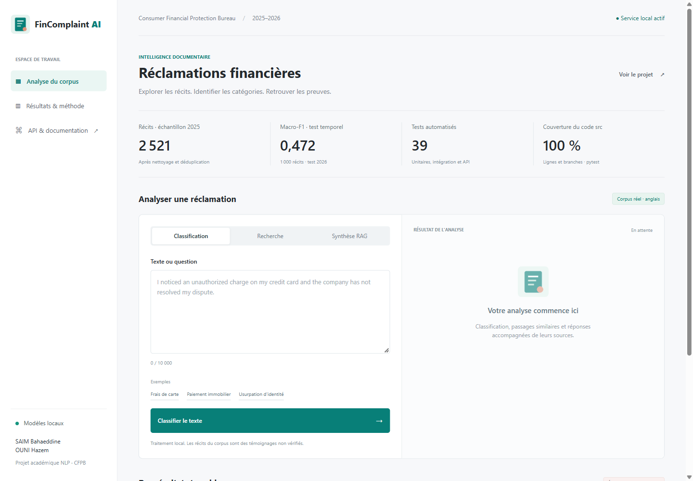
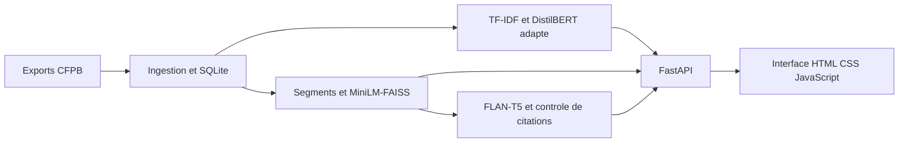

# FinComplaint AI

**Classification de reclamations financieres, recherche semantique et reponses sourcees.**

Projet academique NLP de **SAIM Bahaeddine et OUNI Hazem**. Donnees reelles CFPB 2025-2026.



## Application

Une interface francaise pour classifier une reclamation, retrouver des passages,
generer une reponse et consulter ses sources. Les indicateurs proviennent des rapports
d'execution. Les vrais modeles fonctionnent localement via FastAPI, sans cle API.

```powershell
.venv\Scripts\python.exe -m uvicorn src.api:app --host 127.0.0.1 --port 8012
```

Application : **http://127.0.0.1:8012**. Swagger : **http://127.0.0.1:8012/docs**.
Publier le code sur GitHub ne deploie pas le serveur : l'application reste locale.

## Besoin et architecture

Aider un analyste a categoriser une reclamation, retrouver des recits comparables
et examiner les preuves d'une reponse. Les temoignages ne sont pas des faits verifies.
Le systeme ne fournit pas de conseil financier ou juridique.



```text
src/            Donnees, classification, recherche, generation et API
web/            Application HTML, CSS, JavaScript et asset local
notebooks/      Notebook complet execute et notebooks specialises
tests/          Unitaires, integration, commandes et contrats HTTP
scripts/        Preparation, modeles, execution et verification
reports/final/  Metriques, exemples et preuves de fonctionnement
reports/ui/     Captures desktop et mobile
docs/           Architecture, evaluation et demonstration
```

Point d'entree : [notebook complet execute](notebooks/00_projet_fincomplaint.ipynb).
La logique metier reste dans `src` ; le notebook orchestre les experiences.

## Donnees et droits

Source : [CFPB Narratives Archive](https://www.consumerfinance.gov/foia-requests/foia-electronic-reading-room/cfpb-consumer-complaint-database-narratives-archive/).
Les treize CSV deja suivis dans le depot utilisent Git LFS (4,56 Go).
`download_manifest.json` contient leurs tailles et SHA-256 verifies.

```console
git lfs install
git clone https://github.com/Bahaeddinesaim/FINCOMPLAINT-AI.git
cd FINCOMPLAINT-AI
git lfs pull
```

Champs requis : `Complaint ID`, `Date received`, `Product`, `Consumer complaint narrative`.
Ingestion par blocs, texte original conserve, dates filtrees et doublons normalises exclus.
Les [mentions CFPB](https://www.consumerfinance.gov/privacy/website-privacy-policy/#legal-notices)
distinguent les contenus du Bureau de ceux de tiers. Aucune licence CC0 ou MIT n'est
attribuee automatiquement aux recits. Verifier les droits avant redistribution.
Les poids des modeles conservent les conditions de leurs auteurs.

## Installation et reproduction

Python **3.12** recommande. Environnements, bases, index et poids sont exclus de Git.

```powershell
python -m venv .venv
.venv\Scripts\Activate.ps1
python -m pip install -r requirements-models.txt
python -m scripts.download_models
python -m scripts.execute_project
python -m uvicorn src.api:app --host 127.0.0.1 --port 8012
```

Linux/macOS : `source .venv/bin/activate`. Le premier telechargement exige internet
et plusieurs Go disponibles. Les chemins du projet sont relatifs a sa racine.
Le traitement integral, plus couteux, est distinct : `python run_pipeline.py`.

## Resultats mesures

| Experience | Perimetre | Macro-F1 |
| --- | --- | ---: |
| Baseline TF-IDF/logistique | 2 024 train, 497 validation 2025 | 0,4966 |
| TF-IDF, comparaison avancee | 235 train, 74 validation | 0,5609 |
| DistilBERT, meme comparaison | 235 train, 74 validation | 0,4025 |
| Baseline fixe, test 2026 | 1 000 textes, sans reentrainement | 0,4722 |

Les experiences utilisant des effectifs differents ne sont pas directement comparables.
DistilBERT adapte seulement sa tete, avec encodeur gele. La baseline reste le modele
retenu sur validation. Aucun choix n'est ajuste sur le test temporel 2026.

Preparation : 3 000 premieres lignes de chaque export 2025, puis nettoyage. Test 2026 :
meme limite par fichier, puis au maximum 1 000 recits independants par hash.
Il s'agit d'echantillons de convenance, pas du corpus entier.

Recherche : 300 documents train, segments de 80 mots, recouvrement 15 mots, embeddings
normalises et FAISS cosinus ; comparaison top-3/top-5 avec TF-IDF.
Recall@k/MRR portent sur 12 extraits connus : **pas un benchmark humain independant**.
Generation FLAN-T5 : questions pertinentes et hors domaine, seuil exploratoire 0,35,
brouillons sans citations valides retenus. Un ID valide ne prouve pas la fidelite.

Voir [les preuves](reports/final/FINAL_RESULTS.md) et [le protocole](docs/evaluation.md).

## API

| Route | Fonction |
| --- | --- |
| `GET /` | Interface HTML |
| `GET /project` | Indicateurs mesures |
| `POST /classify` | Produit financier predit |
| `POST /search` | Passages MiniLM-FAISS |
| `POST /ask` | Reponse, sources et statut des citations |

Corps : `{"text":"mortgage escrow payment","k":3}` ; k entre 1 et 5.
Entree invalide : 422. Le service est local et ne fournit pas d'authentification publique.

## Tests et qualite

```powershell
python -m scripts.verify_project
python -m scripts.verify_project --update-notebook
```

Ruff, formatage et pytest avec couverture des lignes et branches de `src`.
Seuil local : 100 %. Les integrations utilisent les vrais checkpoints locaux en mode
hors ligne et ecrivent leurs poids dans des dossiers temporaires. La CI execute les
tests sans integrations lourdes ; la verification complete reste reproductible localement.
Un succes local ne prouve pas qu'une execution GitHub Actions distante a reussi.
Voir [TESTING.md](TESTING.md).

## Documentation

- [Architecture et choix](docs/architecture.md)
- [Evaluation et limites](docs/evaluation.md)
- [Parcours de demonstration](docs/demo.md)
- [Notebook execute](notebooks/00_projet_fincomplaint.ipynb)

**Usage IA :** Codex a assiste l'implementation, les tests et la documentation.
Les chiffres proviennent des executions effectuees ; le binome reste responsable de
la revue, de l'interpretation et de la soutenance. L'evaluation humaine de la fidelite
du RAG et la pertinence metier reste necessaire, independamment de la couverture logicielle.
