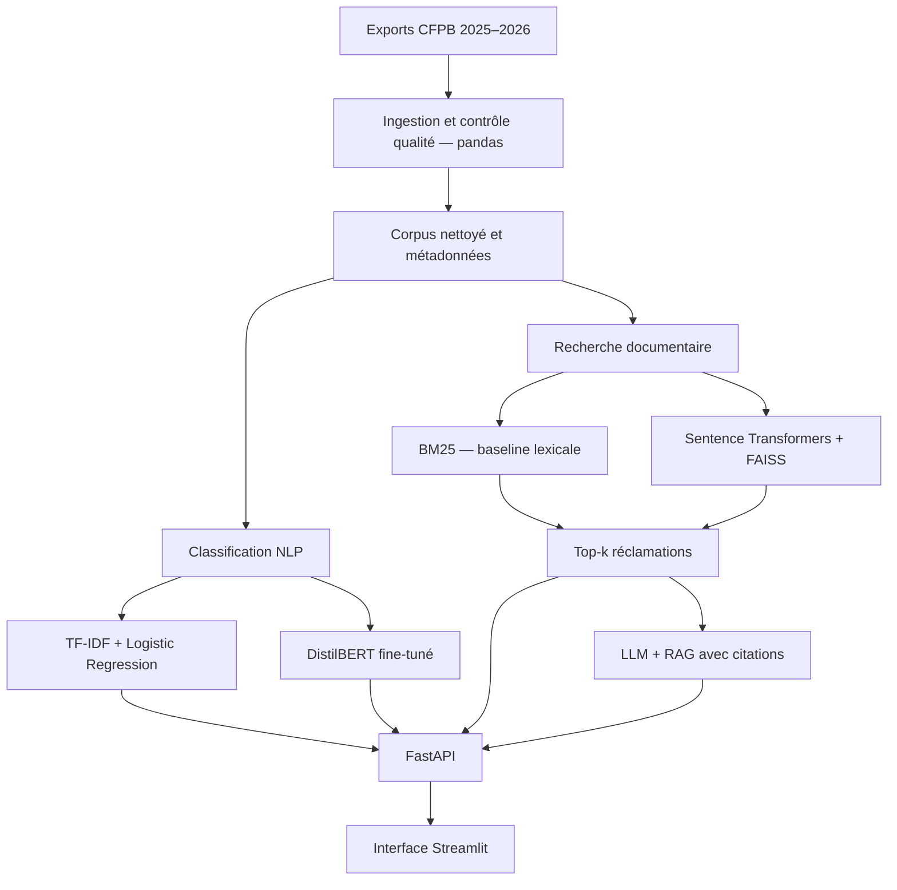

# FinComplaint AI

**Classification intelligente, recherche sémantique et analyse augmentée par récupération (RAG) des réclamations financières.**

> **Statut :** projet NLP en phase de cadrage et de développement. Les performances et fonctionnalités décrites ci-dessous sont des objectifs, pas des résultats déjà obtenus.

**Auteur du cadrage :** SAIM Bahaeddine ; OUNI Hazem 
**Cadre :** projet académique NLP, réalisé en binôme  
**Corpus :** Consumer Financial Protection Bureau (CFPB), données 2025–2026

## 1. Présentation

FinComplaint AI vise à exploiter les récits de réclamations financières publiés par le **Consumer Financial Protection Bureau (CFPB)** pour :

1. **Classifier** automatiquement une réclamation selon son produit financier (*Product*), puis éventuellement son problème (*Issue*).
2. **Retrouver** les réclamations similaires à l'aide d'une recherche lexicale et sémantique.
3. **Synthétiser** les informations pertinentes avec un pipeline **Retrieval-Augmented Generation (RAG)**, en citant les réclamations sources et leurs identifiants.

**Question de recherche :** comment classifier automatiquement les réclamations financières, retrouver des plaintes similaires et produire des synthèses fiables, traçables et fondées sur des documents sources ?

Le système est un outil d'exploration de corpus, **pas** un dispositif de conseil juridique ou financier ni un moteur de résolution automatique des litiges.

## 2. Données

**Source officielle :** [CFPB — Consumer Complaint Database Narratives Archive](https://www.consumerfinance.gov/foia-requests/foia-electronic-reading-room/cfpb-consumer-complaint-database-narratives-archive/)

Le périmètre retenu couvre **2025 et 2026**, conformément à la consigne pédagogique. Le cadrage identifie six exports bimestriels pour 2025 et sept exports pour 2026 (janvier–février, puis mars à août), avec des réclamations reçues jusqu'au **14 août 2026**. La couverture exacte sera vérifiée sur les fichiers téléchargés.

| Période | Usage prévu |
| --- | --- |
| **2025** | Exploration, entraînement et validation des modèles |
| **2026** | Test temporel final sur des données ultérieures |

**Colonnes à contrôler après téléchargement :** `Complaint ID`, `Date received`, `Product`, `Sub-product`, `Issue`, `Sub-issue`, `Consumer complaint narrative` et métadonnées de traitement. Leur disponibilité et leur nom peuvent varier selon les exports.

### Préparation des données

- Télécharger et inventorier les exports CFPB.
- Harmoniser les noms et types de colonnes.
- Filtrer les dates de réception sur 2025–2026.
- Conserver les récits narratifs non vides.
- Dédupliquer par identifiant et rechercher les quasi-doublons.
- Analyser les longueurs de textes, les valeurs manquantes et le déséquilibre des classes.
- Construire un échantillon reproductible si le volume le nécessite.

**Limites du corpus :** les récits publiés ne représentent pas toutes les plaintes, certains éléments sont masqués, et les catégories peuvent être déséquilibrées. Aucun volume exploitable n'est présumé avant l'analyse exploratoire.

## 3. Architecture technique cible



Le prétraitement pourra utiliser **spaCy** pour la normalisation, la tokenisation et la lemmatisation. Le texte original sera conservé pour les modèles qui en ont besoin.

### Classification

- **Baseline :** TF-IDF + régression logistique.
- **Modèle avancé :** fine-tuning de DistilBERT.
- **Cible prioritaire :** `Product`.
- **Extension éventuelle :** `Issue`, sous réserve d'effectifs suffisants par classe.
- **Comparaison :** protocole commun et **macro-F1**, avec matrice de confusion et analyse des erreurs.

### Recherche de plaintes similaires

- **Baseline :** BM25.
- **Recherche vectorielle :** `all-MiniLM-L6-v2` via Sentence Transformers.
- **Index :** FAISS.
- **Sortie :** top-k de plaintes pertinentes, accompagnées de leurs identifiants et extraits.
- **Évaluation :** requêtes annotées manuellement, `Recall@k` et `MRR`.

### Génération RAG

1. Recevoir une question en langage naturel.
2. Retrouver les passages pertinents dans le corpus.
3. Fournir ces passages à un LLM avec des instructions de citation.
4. Générer une synthèse fondée sur les sources, avec **Complaint IDs** et extraits.
5. Signaler l'insuffisance des preuves lorsqu'une réponse fiable n'est pas possible.

Les expériences compareront notamment **top-k = 3** et **top-k = 5**, ainsi que des questions hors corpus. Le système ne devra pas inventer la résolution d'une réclamation.

## 4. Stack technologique envisagée

| Couche | Technologies |
| --- | --- |
| Ingestion et analyse | Python, pandas |
| Prétraitement NLP | spaCy |
| Classification baseline | scikit-learn, TF-IDF, Logistic Regression |
| Classification avancée | Hugging Face Transformers, DistilBERT |
| Embeddings | Sentence Transformers, `all-MiniLM-L6-v2` |
| Recherche | BM25, FAISS |
| Génération | LLM à sélectionner |
| API | FastAPI |
| Interface | Streamlit |
| Évaluation | macro-F1, Recall@k, MRR, fidélité et couverture des citations |

## 5. Structure prévue du dépôt

```text
fincomplaint-ai/
├── data/
│   ├── raw/                  # Exports originaux CFPB
│   ├── processed/            # Données harmonisées
│   └── evaluation/           # Jeux et annotations d'évaluation
├── notebooks/
│   ├── 01_ingestion_eda.ipynb
│   ├── 02_classification.ipynb
│   ├── 03_rag.ipynb
│   └── 04_evaluation.ipynb
├── src/
│   ├── ingestion.py
│   ├── preprocessing.py
│   ├── classifier.py
│   ├── retriever.py
│   ├── rag.py
│   └── metrics.py
├── api/
│   └── main.py
├── app/
│   └── streamlit_app.py
├── tests/
├── requirements.txt
├── .env.example
└── README.md
```

Cette arborescence est **proposée** : les fichiers de code et notebooks doivent être créés au fur et à mesure du développement.

## 6. Installation et exécution (après implémentation)

**Prérequis :** Python et un environnement virtuel ; les versions exactes des dépendances restent à fixer.

```bash
git clone <URL_DU_DEPOT>
cd fincomplaint-ai
python -m venv .venv
```

Activer l'environnement :

```bash
# Linux / macOS
source .venv/bin/activate

# Windows PowerShell
.venv\Scripts\Activate.ps1
```

Lorsque `requirements.txt` aura été renseigné :

```bash
pip install -r requirements.txt
```

Après implémentation de l'API et de l'interface :

```bash
# Terminal 1 — API
uvicorn api.main:app --reload

# Terminal 2 — interface
streamlit run app/streamlit_app.py
```

**Important :** ces commandes correspondent à l'architecture cible. Elles ne garantissent pas un lancement tant que les modules, les dépendances et les configurations n'ont pas été développés.

## 7. API prévue

| Endpoint | Fonction |
| --- | --- |
| `POST /classify` | Prédire la catégorie d'une réclamation |
| `POST /search` | Rechercher les plaintes similaires |
| `POST /ask` | Répondre à une question avec sources et citations |

Les schémas JSON, paramètres, erreurs et exemples de réponses seront documentés après implémentation.

## 8. Protocole d'évaluation

| Composant | Métriques / vérifications |
| --- | --- |
| Classification | Macro-F1, matrice de confusion, analyse par classe |
| Recherche | Recall@k, MRR sur requêtes annotées |
| RAG | Fidélité aux sources, couverture des citations, refus des questions non couvertes |
| Système | Tests fonctionnels, reproductibilité et documentation |

**Prévention des fuites de données :** entraînement et validation sur **2025**, test final réservé à **2026**, contrôle des doublons et quasi-doublons entre périodes. Pour le RAG, utiliser des questions et sources de référence annotées, sans introduire artificiellement les réponses attendues dans l'index d'évaluation.

Aucun score ni résultat expérimental n'est annoncé à ce stade.

## 9. Organisation du travail (proposition)

| Responsable | Périmètre proposé |
| --- | --- |
| **SAIM Bahaeddine** | Ingestion, exploration, qualité des données, classification, métriques |
| **Binôme** | Embeddings, FAISS, RAG, interface de démonstration |
| **En commun** | Protocole d'évaluation, intégration FastAPI, documentation, tests, soutenance |

La répartition doit être validée par les deux membres ; chacun doit comprendre l'ensemble de la solution.

## 10. Roadmap

- [ ] **J1 — Corpus :** téléchargement, inventaire, schéma, distribution des catégories et dates.
- [ ] **J2 — Classification :** baseline et Transformer entraînés, macro-F1 et matrice de confusion.
- [ ] **J3 — RAG :** top-k, réponses sourcées, exemples pertinents et hors corpus.
- [ ] **J4 — Application :** API documentée, interface Streamlit, instructions de lancement.
- [ ] **J5 — Évaluation finale :** comparaisons, analyse des erreurs, limites, démonstration reproductible.

## 11. Risques et précautions

- **Volume :** privilégier une baseline CPU et un échantillon stratifié documenté avant des expériences plus coûteuses.
- **Évolution des labels :** vérifier la cohérence des catégories entre 2025 et 2026.
- **Confidentialité :** ne pas enrichir les données avec des informations personnelles ; vérifier les conditions de publication et de réutilisation du CFPB.
- **Ressources de calcul :** anticiper le besoin éventuel de GPU pour le fine-tuning.
- **LLM externe :** choisir un modèle accessible et ne transmettre aucune donnée non autorisée à un service tiers.
- **Fiabilité :** les plaintes similaires ne constituent pas nécessairement une solution juridique ou financière ; les réponses générées doivent être vérifiables.

## 12. Référence

**Consumer Financial Protection Bureau (CFPB)** — [Consumer Complaint Database Narratives Archive](https://www.consumerfinance.gov/foia-requests/foia-electronic-reading-room/cfpb-consumer-complaint-database-narratives-archive/). Source citée dans le cadrage du **6 novembre 2026**.

---

*FinComplaint AI — Projet NLP académique | Cadrage préparé par SAIM Bahaeddine.*
